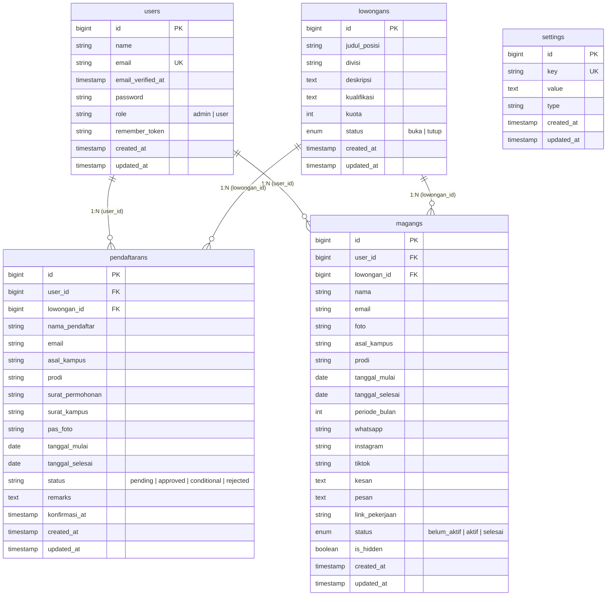
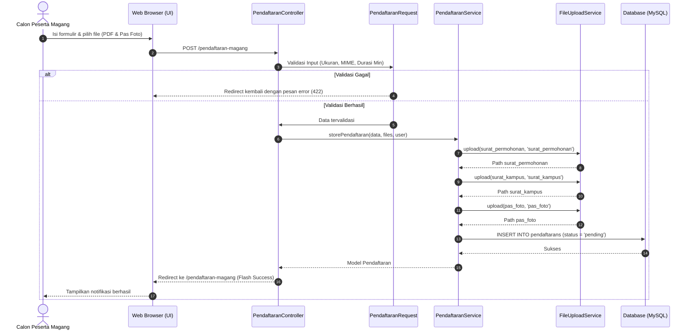
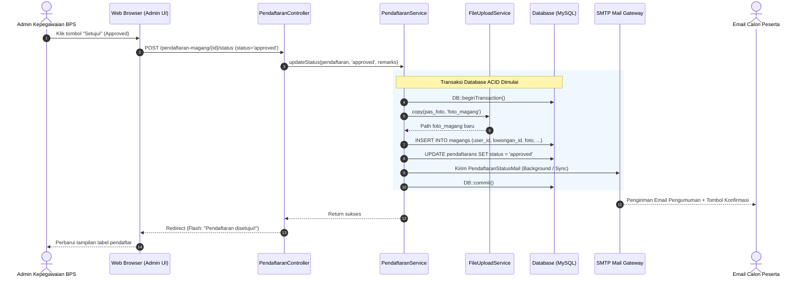
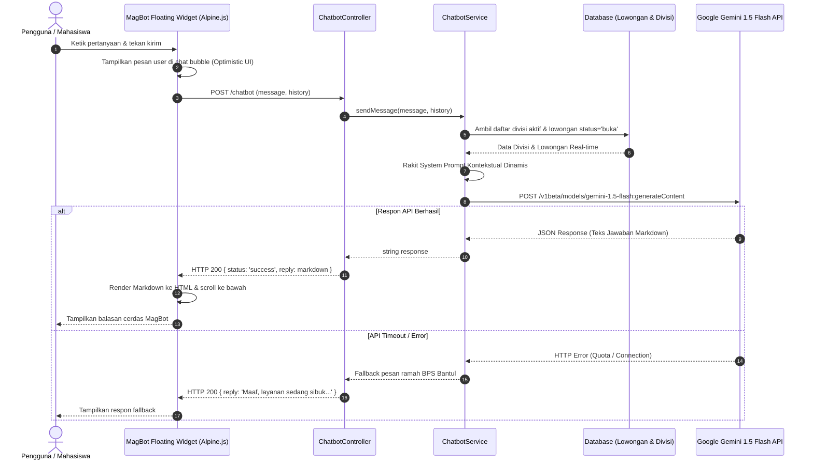
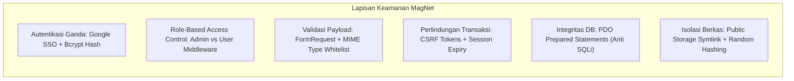

# 🏛️ Architecture Documentation
## MagNet — Sistem Informasi Manajemen & Pendaftaran Magang
**Badan Pusat Statistik (BPS) Kabupaten Bantul**

---

## 1. 📌 Informasi Dokumen
* **Nama Sistem:** MagNet (*Magang Network*)
* **Instansi Pemilik:** Badan Pusat Statistik (BPS) Kabupaten Bantul
* **Versi Dokumen:** 1.0.0
* **Status:** Approved / Active Architecture Specification
* **Referensi Terkait:** [PRD Document](file:///c:/xampp/htdocs/magnet/docs/prd.md)

---

## 2. 🎯 Ringkasan Arsitektur & Prinsip Desain

### 2.1. Arsitektural Gaya (*Architectural Style*)
MagNet dibangun menggunakan pendekatan **Modular Monolithic Layered Architecture** berbasis framework **Laravel 11.x (PHP 8.2+)**. Sistem ini mengombinasikan pola klasik **Model-View-Controller (MVC)** dengan **Service Layer Pattern** untuk memisahkan logika bisnis yang kompleks dari lapisan HTTP (*Thin Controller, Fat Service*).

### 2.2. Prinsip Rekayasa (*Core Principles*)
1. **Separation of Concerns (SoC):** Pemisahan yang jelas antara antarmuka (Blade), routing & proteksi HTTP (Middleware), penanganan permintaan (Controller), logika bisnis & transaksi data (Service Layer), serta pemodelan data (Eloquent ORM).
2. **Transactional Data Integrity:** Setiap alur persetujuan (*approval*) dan pemindahan data pelamar menjadi peserta magang dijalankan di dalam blok transaksi database ACID (`DB::transaction`) untuk mencegah inkonsistensi data.
3. **Security by Design:** Autentikasi berbasis *Role-Based Access Control* (RBAC), proteksi CSRF otomatis, sanitasi XSS bawaan Blade engine, validasi ketat MIME type berkas, dan pencegahan SQL Injection via PDO parameter binding.
4. **Dynamic Context-Aware AI:** Integrasi asisten virtual cerdas (*MagBot*) yang memanfaatkan Google Gemini API dengan penyusunan *system prompt* yang dinamis dari basis data secara *real-time*.

---

## 3. 🌐 Tinjauan Arsitektur Sistem Tingkat Tinggi

Diagram berikut mengilustrasikan interaksi tingkat tinggi antara pengguna, batasan sistem MagNet, serta layanan eksternal pihak ketiga:

```mermaid
graph TB
    subgraph Users ["Pengguna Sistem"]
        U_Mhs["Calon Peserta Magang / Mahasiswa"]
        U_Adm["Admin Kepegawaian BPS Bantul"]
        U_Pub["Publik / Guest"]
    end

    subgraph Boundaries ["Sistem Informasi MagNet (BPS Bantul)"]
        WebTier["Web Server & Gateway (Apache / Nginx)"]
        AppTier["Aplikasi Inti Laravel 11 (PHP 8.2+)\n[Routing, Middleware, Controller, Service Layer]"]
        DataTier[("Database Relasional (MySQL 8.0+)")]
        FileStorage["Penyimpanan Berkas Lokal\n[storage/app/public]"]
    end

    subgraph ExternalServices ["Layanan Eksternal Pihak Ketiga"]
        GoogleAuth["Google Identity Platform\n(OAuth 2.0 Single Sign-On)"]
        GeminiAI["Google Gemini 1.5 Flash API\n(Engine Kecerdasan MagBot)"]
        MailServer["SMTP Mail Server\n(Notifikasi Email Otomatis)"]
    end

    U_Mhs -->|HTTPS / Browser| WebTier
    U_Adm -->|HTTPS / Browser| WebTier
    U_Pub -->|Akses Publik & Konfirmasi| WebTier

    WebTier --> AppTier
    AppTier --> DataTier
    AppTier --> FileStorage

    AppTier -->|OAuth 2.0 Protocol| GoogleAuth
    AppTier -->|REST API (HTTPS/JSON)| GeminiAI
    AppTier -->|SMTP Protocol (TLS)| MailServer
```

---

## 4. 🧱 Lapisan Arsitektur Aplikasi (*Layered Application Architecture*)

Arsitektur aplikasi MagNet terbagi ke dalam 5 (lima) lapisan fungsional yang terdefinisi dengan jelas:

```mermaid
graph TD
    subgraph L1 ["1. Presentation Layer (Antarmuka Pengguna)"]
        Blade["Blade Templating Engine"]
        Tailwind["Tailwind CSS (UI & Styling)"]
        Alpine["Alpine.js (Interaktivitas Komponen & Modal)"]
        ChartJS["Chart.js (Visualisasi Statistik Dashboard)"]
    end

    subgraph L2 ["2. HTTP & Routing Layer"]
        Routes["Web Routes (routes/web.php & auth.php)"]
        MW_Auth["Auth Middleware ('auth')"]
        MW_Admin["Admin Middleware ('admin')"]
        MW_Guest["Guest Middleware ('guest')"]
        MW_Sec["Security Middleware (CSRF, Sessions, Throttle)"]
    end

    subgraph L3 ["3. Controller & Request Layer"]
        FormReq["Form Requests (Validation Rules)"]
        Controllers["HTTP Controllers\n- PendaftaranController\n- MagangController\n- LowonganController\n- DivisiController\n- SettingController\n- DashboardController\n- ChatbotController\n- Auth Controllers"]
    end

    subgraph L4 ["4. Service Layer (Logika Bisnis & Transaksi)"]
        PendaftaranSvc["PendaftaranService"]
        MagangSvc["MagangService"]
        FileUploadSvc["FileUploadService"]
        DashAnalyticsSvc["DashboardAnalyticsService"]
        ChatbotSvc["ChatbotService"]
    end

    subgraph L5 ["5. Domain & Persistence Layer"]
        Models["Eloquent Models\n(User, Lowongan, Pendaftaran, Magang, Setting)"]
        BootLifecycle["Model Boot Lifecycle (Observer Durasi & Status)"]
        Database[("MySQL Relational Database")]
        DiskStorage["File System Storage (Symlinked Public Storage)"]
    end

    L1 --> L2
    L2 --> L3
    L3 --> L4
    L4 --> L5
```



### Rincian Tanggung Jawab Tiap Lapisan:

| Lapisan (*Layer*) | Komponen Utama | Tanggung Jawab Utama |
| :--- | :--- | :--- |
| **Presentation Layer** | Blade, Tailwind CSS, Alpine.js, Chart.js | Merender antarmuka web responsif, menangani manipulasi DOM sisi klien, menampilkan grafik agregasi, dan memfasilitasi formulir dinamis. |
| **HTTP & Routing Layer** | Laravel Router, Route Groups, Middleware Pipeline | Menerima *request* HTTP, menerapkan pembatasan rute (*guards*), memeriksa role pengguna, memvalidasi token CSRF, dan mengatur masa aktif sesi. |
| **Controller Layer** | HTTP Controllers & Form Requests | Menerima payload permintaan, memicu validasi data via `FormRequest`, mendelegasikan proses ke Service Layer, dan mengembalikan tampilan (*View*) atau respon JSON. |
| **Service Layer** | Domain Services (`app/Services/*`) | Mengisolasi seluruh proses bisnis, mengelola transaksi ACID, mengunggah dan menghapus dokumen fisik, menghitung metrik analitik, serta berkomunikasi dengan AI. |
| **Persistence Layer** | Eloquent Models, Observers, MySQL, File System | Memetakan objek ke tabel database (*Object-Relational Mapping*), menjalankan validasi integritas referensial, dan mengelola arsip dokumen fisik pada disk lokal. |

---

## 5. 🧩 Spesifikasi Komponen & Modul Sistem

### 5.1. Matriks Service Layer
Service Layer bertindak sebagai pengatur (*orchestrator*) bisnis sistem MagNet:

```
app/Services/
├── ChatbotService.php           -> Integrasi Google Gemini API, konstruksi prompt kontekstual
├── DashboardAnalyticsService.php -> Kalkulasi metrik agregat, tren pendaftaran, distribusi kampus
├── FileUploadService.php        -> Validasi MIME, sanitasi nama, upload, dan penghapusan berkas
├── MagangService.php            -> Manajemen direktori peserta aktif, alumni, dan visibilitas
└── PendaftaranService.php       -> Alur pendaftaran, workflow persetujuan, transaksi DB, kirim email
```

* **`PendaftaranService`:**
  * `getFilteredPendaftarans(User $user, array $filters)`: Menyaring data pelamar dengan paginasi dan tab status penghitung (*counters*).
  * `storePendaftaran(array $validated, array $files, User $user)`: Menyimpan pendaftaran baru beserta unggahan dokumen.
  * `updateStatus(Pendaftaran $pendaftaran, string $status, ?string $remarks)`: Mengelola alur persetujuan:
    * Jika `approved`: Memindahkan data ke tabel `magangs`, menyalin foto profil fisik, memperbarui status pendaftaran, dan memicu `PendaftaranStatusMail`.
    * Jika `conditional` / `rejected`: Mencatat `remarks` dan mengirim notifikasi email penjelasan.
  * `konfirmasiKehadiran(Pendaftaran $pendaftaran)`: Memproses konfirmasi kehadiran publik tanpa login ulang.
* **`MagangService`:**
  * `updateMagang(Magang $magang, array $validated, $fotoFile)`: Memperbarui biodata peserta, sosial media, dan portofolio.
  * `deleteMagang(Magang $magang)`: Menghapus data peserta magang, menghapus file foto fisik, dan mengarsipkan status pendaftaran terkait menjadi `rejected`.
  * `toggleVisibility(Magang $magang)`: Mengubah status `is_hidden` untuk menyembunyikan/menampilkan profil dari publik.
* **`FileUploadService`:**
  * `upload(UploadedFile $file, string $folder, ?string $oldPath)`: Menyimpan berkas dengan nama acak unik dan menghapus berkas lama jika ada penggantian.
  * `delete(?string $path)`: Menghapus berkas fisik dari storage jika ada.
* **`ChatbotService`:**
  * `buildSystemPrompt()`: Mengambil daftar divisi aktif dan lowongan buka secara dinamis untuk disuntikkan ke prompt panduan AI.
  * `sendMessage(string $message, array $history)`: Mengirim percakapan ke Google Gemini 1.5 Flash endpoint via Laravel HTTP Client.
* **`DashboardAnalyticsService`:**
  * `getAdminDashboardData(string $selectedYear)`: Menghitung distribusi pelamar, grafik pendaftaran bulanan, sebaran kampus asal, dan daftar peserta aktif.

---

## 6. 🗄️ Arsitektur Data & Skema Database

Sistem menggunakan database relasional **MySQL 8.0+** yang dikelola melalui migrasi Laravel.



### Strategi Integritas & Siklus Hidup Data (*Data Lifecycle*):
1. **Model Booting Hook pada `Magang`:**
   Saat data peserta magang disimpan (`saving` event di `Magang::boot()`), sistem secara otomatis menghitung durasi pelaksanaan (`periode_bulan`) serta memperbarui status kepesertaan berdasarkan waktu sistem:
   $$\text{Status} = \begin{cases} \text{belum\_aktif}, & \text{hari ini} < \text{tanggal\_mulai} \\ \text{aktif}, & \text{tanggal\_mulai} \le \text{hari ini} \le \text{tanggal\_selesai} \\ \text{selesai}, & \text{hari ini} > \text{tanggal\_selesai} \end{cases}$$
2. **Kaskade Foreign Key:**
   Kolom `lowongan_id` pada tabel `pendaftarans` dan `magangs` menggunakan konfigurasi `nullOnDelete()`, sehingga jika suatu formasi lowongan dihapus, riwayat pendaftaran dan kepesertaan peserta tetap aman tersimpan tanpa menyebabkan *orphan records*.

---

## 7. 🔄 Alur & Diagram Sekuensial Sistem (*Key System Workflows*)

### 7.1. Alur Pengajuan Pendaftaran Magang (User)
Alur ketika calon peserta magang mengajukan permohonan dan mengunggah berkas persyaratan:



---

### 7.2. Alur Keputusan Verifikasi & Approval (Admin)
Alur transaksi kritis ketika Admin BPS menyetujui pendaftar magang menjadi peserta resmi:



---

### 7.3. Alur Interaksi Asisten Cerdas MagBot (AI Integration)
Alur tanya jawab interaktif calon pendaftar dengan mesin AI:



---

## 8. 🛡️ Arsitektur Keamanan (*Security Architecture*)



1. **Autentikasi & Pengelolaan Sesi:**
   * Sesi diatur dengan masa aktif 15 menit (`SESSION_LIFETIME=15`) dan opsi *expire on close* aktif untuk mencegah penyalahgunaan sesi di komputer publik/kampus.
   * Kata sandi akun administrator dienkripsi menggunakan algoritma *Bcrypt* dengan *work factor* adaptif.
   * Autentikasi Google SSO hanya diperuntukkan bagi akun pemohon (`user`), sedangkan akun `admin` diwajibkan menggunakan kredensial internal untuk mencegah *account takeover*.
2. **Otorisasi & Akses Kontrol (RBAC):**
   * Rute administratif dilindungi oleh `AdminMiddleware`. Upaya akses ilegal oleh pengguna ber-role `user` otomatis dialihkan (*abort 403 / redirect*).
   * Operasi pengeditan profil magang dan dokumen pendaftaran dibatasi oleh klausul kepemilikan (`auth()->id() === $model->user_id`).
3. **Keamanan Unggah Berkas (*File Upload Security*):**
   * Berkas dibatasi ketat: Surat Permohonan & Surat Kampus wajib bertipe `application/pdf` dengan batasan maksimal 1024 KB. Pas Foto wajib bertipe gambar `jpeg, png, jpg` dengan batasan maksimal 2048 KB.
   * Nama file fisik di-hash secara acak menggunakan timestamp unik untuk mencegah serangan *Directory Traversal* atau eksekusi file berbahaya.
4. **Proteksi Injeksi & Penyerangan Web:**
   * Seluruh query database dibangun di atas Laravel Eloquent Query Builder yang menggunakan *PDO parameter binding* secara otomatis (kebal terhadap serangan SQL Injection).
   * Seluruh data dinamis yang ditampilkan ke antarmuka pengguna di-render melalui sintaks Blade escape `{{ $variable }}` untuk menetralkan potensi serangan *Cross-Site Scripting* (XSS).
   * Setiap permintaan metode `POST`, `PUT`, `PATCH`, dan `DELETE` diproteksi oleh token verifikasi *Cross-Site Request Forgery* (CSRF).

---

## 9. 🚀 Topologi Infrastruktur & Lingkungan (*Deployment Architecture*)

```mermaid
graph TB
    subgraph ClientEnv ["Lingkungan Klien"]
        BrowserDesktop["Web Browser Desktop (Chrome, Edge, Firefox)"]
        BrowserMobile["Mobile Web Browser (Android, iOS)"]
    end

    subgraph ServerEnv ["Lingkungan Server Web / Host (XAMPP / Linux VPS)"]
        WebServer["Web Server (Apache / Nginx)\nDocument Root: /public"]
        PHPRuntime["PHP 8.2+ Runtime Engine\n- PDO MySQL Extension\n- Fileinfo Extension\n- cURL Extension\n- OpenSSL Extension"]
        StorageFS["Storage Subsystem\n- /storage/app/public\n- Symlinked to /public/storage"]
    end

    subgraph DatabaseEnv ["Basis Data Server"]
        MySQLServer["MySQL Database Server 8.0+\nPort: 3306"]
    end

    ClientEnv -->|Port 80 / 443| WebServer
    WebServer --> PHPRuntime
    PHPRuntime --> StorageFS
    PHPRuntime -->|Port 3306 (TCP)| MySQLServer
```

### Spesifikasi Kebutuhan Lingkungan Operasional:
* **Bahasa Pemrograman & Runtime:** PHP $\ge$ 8.2 dengan ekstensi wajib `pdo_mysql`, `curl`, `fileinfo`, `mbstring`, `openssl`, `tokenizer`.
* **Database Management System:** MySQL $\ge$ 8.0 atau MariaDB $\ge$ 10.4 dengan dukungan *InnoDB Storage Engine*.
* **Web Server:** Apache HTTP Server dengan modul `mod_rewrite` aktif, atau Nginx dengan konfigurasi `try_files $uri $uri/ /index.php?$query_string;`.
* **Akses Jaringan Luar:** Koneksi internet aktif untuk server guna memfasilitasi komunikasi keluar (*outbound HTTPS*) ke:
  * Google OAuth API (`https://accounts.google.com`)
  * Google Gemini API (`https://generativelanguage.googleapis.com`)
  * SMTP Server BPS / Google Mail (`smtp.gmail.com` port 587/465)

---

## 10. 📝 Catatan Keputusan Arsitektur (*Architectural Decision Records - ADR*)

### ADR-01: Penerapan Service Layer pada Monolitik Laravel
* **Status:** Diterima (*Accepted*)
* **Konteks:** Logika persetujuan pendaftaran melibatkan banyak langkah bersamaan: transaksi database, manipulasi berkas fisik foto, mutasi data peserta magang, dan pengiriman email. Meletakkan logika ini di dalam Controller akan menyebabkan *fat controller* yang sulit diuji dan dipelihara.
* **Keputusan:** Mengadopsi Service Layer (`app/Services/PendaftaranService.php`, `app/Services/MagangService.php`, dll.) untuk menampung seluruh proses bisnis dan transaksi database.
* **Konsekuensi:** Controller tetap ramping (*thin*), pengujian logika lebih terisolasi, dan proses bisnis dapat digunakan kembali di berbagai endpoint tanpa duplikasi kode.

### ADR-02: Integrasi Google Gemini 1.5 Flash untuk MagBot
* **Status:** Diterima (*Accepted*)
* **Konteks:** Calon pelamar sering menanyakan pertanyaan berulang terkait kualifikasi divisi, jadwal, dan syarat berkas yang telah tercatat di sistem.
* **Keputusan:** Mengintegrasikan model LLM Google Gemini 1.5 Flash via REST API dengan teknik *dynamic prompt injection* dari database BPS Bantul secara *real-time*.
* **Konsekuensi:** Asisten virtual memberikan jawaban yang selalu akurat dengan ketersediaan kuota dan divisi terkini tanpa memerlukan pelatihan ulang model (*fine-tuning*).

### ADR-03: Dual-Mode Autentikasi Pengguna
* **Status:** Diterima (*Accepted*)
* **Konteks:** Mahasiswa membutuhkan proses registrasi yang cepat dan bebas hambatan (*frictionless onboarding*), sedangkan akun administrator kepegawaian membutuhkan proteksi keamanan tinggi.
* **Keputusan:** Mahasiswa diizinkan masuk menggunakan akun Google (Google SSO) atau email/password. Administrator dibatasi secara ketat hanya dapat masuk menggunakan pasangan email dan password yang terdaftar di sistem.
* **Konsekuensi:** Meningkatkan kenyamanan pendaftar tanpa mengorbankan postur keamanan akun pengelola BPS.

### ADR-04: Penyimpanan Konfigurasi Dinamis melalui Tabel `settings`
* **Status:** Diterima (*Accepted*)
* **Konteks:** Batas minimal durasi magang dan daftar divisi BPS dapat berubah sewaktu-waktu sesuai kebijakan kepala instansi tanpa intervensi developer (*re-deployment*).
* **Keputusan:** Membuat tabel `settings` bertipe *key-value pair* (dengan dukungan serialisasi JSON) yang dapat dikonfigurasi langsung oleh Administrator melalui antarmuka sistem.
* **Konsekuensi:** Fleksibilitas operasional maksimal bagi tim BPS Kabupaten Bantul tanpa perlu mengubah kode program.
