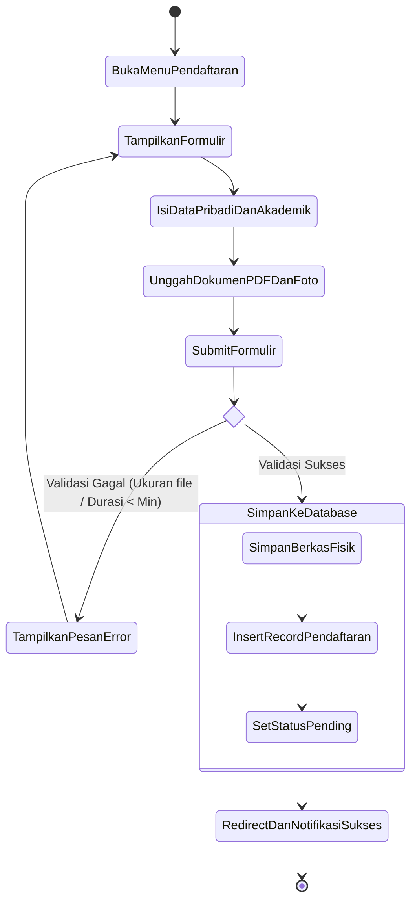
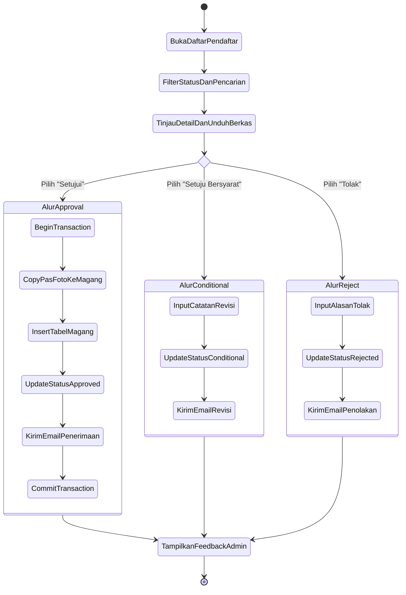
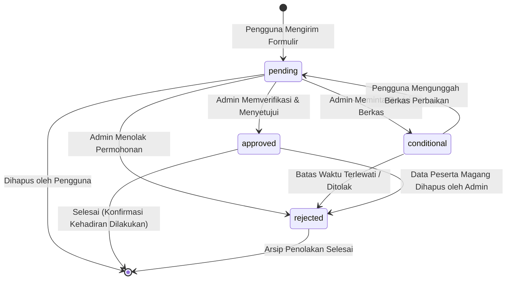
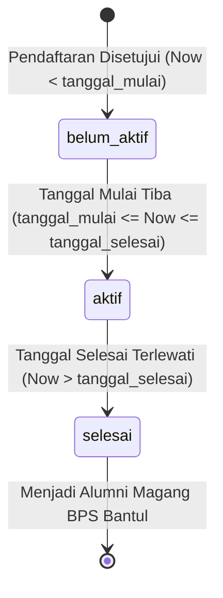
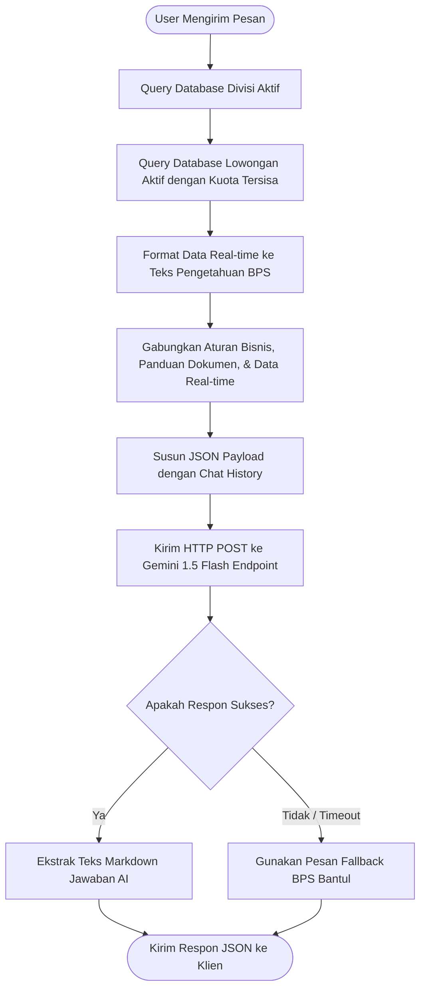
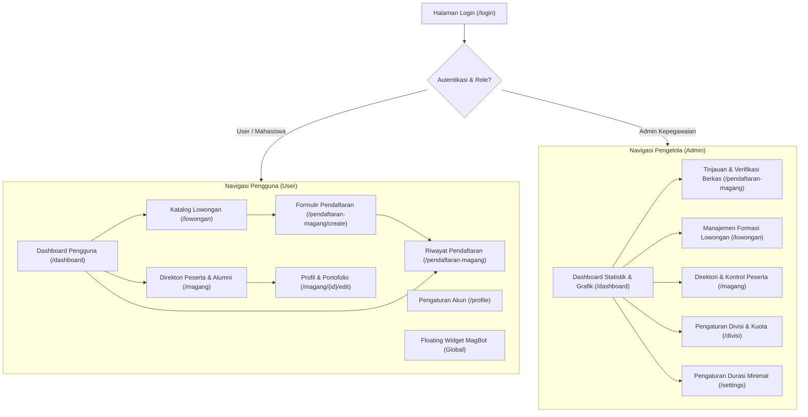

# 📐 System Design Document (SDD)
## MagNet — Sistem Informasi Manajemen & Pendaftaran Magang
**Badan Pusat Statistik (BPS) Kabupaten Bantul**

---

## 1. 📌 Informasi Dokumen
* **Nama Sistem:** MagNet (*Magang Network*)
* **Instansi Pemilik:** Badan Pusat Statistik (BPS) Kabupaten Bantul
* **Versi Dokumen:** 1.0.0
* **Status:** Approved / Active System Specification
* **Dokumen Terkait:**
  * [Product Requirements Document (PRD)](file:///c:/xampp/htdocs/magnet/docs/prd.md)
  * [Software Architecture Document (Architecture)](file:///c:/xampp/htdocs/magnet/docs/architecture.md)

---

## 2. 🎯 Tujuan & Cakupan Perancangan Sistem

Dokumen **System Design Document (SDD)** ini menyajikan spesifikasi perancangan teknis terperinci untuk aplikasi web **MagNet**. Perancangan mencakup pemodelan perilaku sistem (*Behavioral Models*), struktur objek (*Structural Models*), kamus data (*Data Dictionary*), katalog rute (*Route & API Specifications*), spesifikasi algoritma bisnis, serta rancangan antarmuka pengguna (*UI Screen Flow*).

Dokumen ini disusun untuk menjembatani kebutuhan fungsional (PRD) dan arsitektur tingkat tinggi (Architecture) menjadi cetak biru implementasi teknis yang siap pakai, terukur, dan memenuhi standar dokumentasi akademis/skripsi.

---

## 3. 👥 Pemodelan Use Case & Aktor

### 3.1. Definisi Aktor
Sistem MagNet melibatkan 3 (tiga) kategori aktor:
1. **Admin (Tim Pengelola Magang BPS Bantul):** Memiliki kendali penuh atas manajemen lowongan, pengelolaan divisi dan kuota, verifikasi berkas, penetapan status pelamar, serta monitoring direktori peserta dan analitik dashboard.
2. **User (Calon Peserta / Mahasiswa):** Memiliki hak untuk mengeksplorasi lowongan, mengajukan permohonan magang, mengunggah dan memperbaiki berkas, memantau riwayat status, serta berinteraksi dengan AI MagBot.
3. **Public / Guest:** Pengguna tanpa sesi login yang dapat mengakses halaman beranda publik, formulir login/registrasi, serta mengakses tautan token konfirmasi kehadiran dari email.

---

### 3.2. Diagram Use Case Lengkap (UML)

```mermaid
flowchart LR
    %% Actors
    Admin((fa:fa-user Admin BPS))
    User((fa:fa-user Calon Peserta Magang))

    subgraph SystemBoundary ["Sistem Informasi Manajemen Magang (MagNet)"]
        %% Central Login
        Login(["Login Sistem (SSO / Kredensial)"])

        %% Admin Main Use Cases
        UC_Lowongan(["Mengelola Data Lowongan Magang"])
        UC_Divisi(["Mengelola Divisi dan Kuota"])
        UC_Peserta(["Mengelola Data Peserta & Alumni"])
        UC_Verifikasi(["Verifikasi & Approval Pendaftaran"])
        UC_Setting(["Mengelola Pengaturan Durasi"])
        UC_DashAdmin(["Melihat Dashboard & Analitik"])
        UC_Email(["Kirim Notifikasi Email Otomatis"])

        %% Admin Satellites
        sat_low1(["Input Lowongan"])
        sat_low2(["Edit Lowongan"])
        sat_low3(["Delete Lowongan"])
        sat_low4(["Cari Lowongan"])

        sat_div1(["Input Divisi"])
        sat_div2(["Edit Divisi & Kuota"])
        sat_div3(["Delete Divisi"])
        sat_div4(["Reset Kuota Terpakai"])

        sat_pes1(["Input Peserta"])
        sat_pes2(["Edit Peserta"])
        sat_pes3(["Delete Peserta"])
        sat_pes4(["Cari / Toggle Alumni"])

        sat_ver1(["Verifikasi Berkas Persyaratan"])
        sat_ver2(["Setujui Pendaftaran"])
        sat_ver3(["Setujui Bersyarat (Revisi)"])
        sat_ver4(["Tolak Pendaftaran"])
        sat_ver5(["Unduh Berkas Persyaratan"])

        sat_set1(["Ubah Durasi Magang"])

        %% User Main Use Cases
        UC_Daftar(["Melakukan Pendaftaran Magang"])
        UC_Status(["Memantau Status Pendaftaran"])
        UC_KatLowongan(["Melihat Informasi Lowongan & Kuota"])
        UC_DirPeserta(["Melihat Direktori Peserta & Alumni"])
        UC_MagBot(["Interaksi Layanan MagBot (AI)"])

        %% User Satellites & Extensions
        sub_form(["Mengisi Formulir Pendaftaran"])
        sub_berkas(["Mengunggah Berkas Persyaratan"])
        ext_revisi(["Memperbaiki Berkas Pendaftaran"])
        ext_konfirm(["Melakukan Konfirmasi Kehadiran"])
    end

    %% Admin Connections
    Admin --- UC_Lowongan
    Admin --- UC_Divisi
    Admin --- UC_Peserta
    Admin --- UC_Verifikasi
    Admin --- UC_Setting
    Admin --- UC_DashAdmin

    %% Admin Include to Login
    UC_Lowongan -. "<<include>>" .-> Login
    UC_Divisi -. "<<include>>" .-> Login
    UC_Peserta -. "<<include>>" .-> Login
    UC_Verifikasi -. "<<include>>" .-> Login
    UC_Setting -. "<<include>>" .-> Login
    UC_DashAdmin -. "<<include>>" .-> Login

    %% Admin Satellites Connections
    sat_low1 -.-> UC_Lowongan
    sat_low2 -.-> UC_Lowongan
    sat_low3 -.-> UC_Lowongan
    sat_low4 -.-> UC_Lowongan

    sat_div1 -.-> UC_Divisi
    sat_div2 -.-> UC_Divisi
    sat_div3 -.-> UC_Divisi
    sat_div4 -.-> UC_Divisi

    sat_pes1 -.-> UC_Peserta
    sat_pes2 -.-> UC_Peserta
    sat_pes3 -.-> UC_Peserta
    sat_pes4 -.-> UC_Peserta

    sat_ver1 -.-> UC_Verifikasi
    sat_ver2 -.-> UC_Verifikasi
    sat_ver3 -.-> UC_Verifikasi
    sat_ver4 -.-> UC_Verifikasi
    sat_ver5 -.-> UC_Verifikasi
    UC_Verifikasi -. "<<include>>" .-> UC_Email

    sat_set1 -.-> UC_Setting

    %% User Connections
    User --- UC_Daftar
    User --- UC_Status
    User --- UC_KatLowongan
    User --- UC_DirPeserta
    User --- UC_MagBot

    %% User Include to Login
    UC_Daftar -. "<<include>>" .-> Login
    UC_Status -. "<<include>>" .-> Login
    UC_KatLowongan -. "<<include>>" .-> Login
    UC_DirPeserta -. "<<include>>" .-> Login
    UC_MagBot -. "<<include>>" .-> Login

    %% User Sub & Extend
    sub_form -.-> UC_Daftar
    UC_Daftar -. "<<include>>" .-> sub_berkas
    ext_revisi -. "<<extend>>" .-> UC_Status
    ext_konfirm -. "<<extend>>" .-> UC_Status
```



---

### 3.3. Spesifikasi Skenario Use Case Kunci

#### UC-01: Verifikasi & Approval Pendaftaran
* **Aktor:** Admin Kepegawaian BPS
* **Pre-condition:** Admin telah login, terdapat data pendaftaran dengan status `pending` atau `conditional`.
* **Post-condition:** Status pendaftaran diperbarui, peserta magang baru tercatat pada tabel `magangs` (jika *approved*), dan notifikasi email terkirim.
* **Alur Normal (Approval):**
  1. Admin membuka menu pendaftaran magang dan memfilter status `pending`.
  2. Admin memilih pelamar dan memeriksa berkas dokumen (Surat Permohonan, Surat Kampus, Pas Foto).
  3. Admin memilih aksi **"Setujui Pendaftaran"**.
  4. Sistem membuka transaksi database (`DB::beginTransaction`).
  5. Sistem menggandakan pas foto ke direktori `foto_magang/`.
  6. Sistem menyisipkan data baru ke tabel `magangs` dengan status default `belum_aktif`.
  7. Sistem mengubah status pada tabel `pendaftarans` menjadi `approved`.
  8. Sistem mengirimkan email notifikasi kelulusan dengan tombol tautan konfirmasi kehadiran.
  9. Sistem melakukan `DB::commit` dan menampilkan pesan sukses ke Admin.
* **Alur Alternatif (Setuju Bersyarat / Revisi):**
  1. Admin menemukan berkas yang belum memenuhi standar dan memilih aksi **"Setujui Bersyarat"**.
  2. Admin memasukkan catatan perbaikan pada field `remarks`.
  3. Sistem mengubah status pendaftaran menjadi `conditional`.
  4. Sistem mengirimkan email instruksi perbaikan kepada pelamar.
* **Alur Alternatif (Penolakan):**
  1. Admin memilih aksi **"Tolak Pendaftaran"** dan mengisi alasan penolakan pada `remarks`.
  2. Sistem mengubah status pendaftaran menjadi `rejected`.
  3. Sistem mengirimkan email pemberitahuan penolakan.

---

## 4. 🔄 Pemodelan Aktivitas (*Activity Diagrams*)

### 4.1. Activity Diagram: Alur Pendaftaran Magang (User)



---

### 4.2. Activity Diagram: Verifikasi & Seleksi Berkas (Admin)



---

## 5. 🏷️ Diagram Mesin Keadaan (*State Machine Diagrams*)

### 5.1. Siklus Hidup Status Pendaftaran (`pendaftarans.status`)



### 5.2. Siklus Hidup Status Peserta Magang (`magangs.status`)

Status peserta magang dihitung secara otomatis oleh sistem melalui *Eloquent saving event* pada model [`Magang`](file:///c:/xampp/htdocs/magnet/app/Models/Magang.php):



---

## 6. 🏛️ Diagram Kelas (*Class Diagram*)

Diagram kelas berikut menggambarkan struktur kelas kontroler, layanan (*services*), model (*domain models*), dan relasi antar komponen di dalam arsitektur MagNet:

```mermaid
classDiagram
    %% Controllers
    class PendaftaranController {
        -PendaftaranService pendaftaranService
        -FileUploadService fileService
        +index(Request) View
        +create() View
        +store(PendaftaranRequest) RedirectResponse
        +show(Pendaftaran) View
        +edit(Pendaftaran) View
        +update(PendaftaranRequest, Pendaftaran) RedirectResponse
        +destroy(Pendaftaran) RedirectResponse
        +updateStatus(Request, Pendaftaran) RedirectResponse
        +downloadFile(Pendaftaran, String) BinaryFileResponse
        +konfirmasiKehadiran(Pendaftaran) View
    }

    class MagangController {
        -MagangService magangService
        -FileUploadService fileService
        +index(Request) View
        +create() View
        +store(MagangRequest) RedirectResponse
        +show(Magang) View
        +edit(Magang) View
        +update(MagangRequest, Magang) RedirectResponse
        +destroy(Magang) RedirectResponse
        +toggleVisibility(Magang) JsonResponse
    }

    class ChatbotController {
        -ChatbotService chatbotService
        +chat(Request) JsonResponse
    }

    class DashboardController {
        -DashboardAnalyticsService analyticsService
        +index(Request) View
    }

    %% Services
    class PendaftaranService {
        -FileUploadService fileService
        +getFilteredPendaftarans(User, Array) Array
        +storePendaftaran(Array, Array, User) Pendaftaran
        +updatePendaftaran(Pendaftaran, Array, Array) Pendaftaran
        +updateStatus(Pendaftaran, String, String) Array
        +konfirmasiKehadiran(Pendaftaran) Boolean
    }

    class MagangService {
        -FileUploadService fileService
        +createMagang(Array, UploadedFile) Magang
        +updateMagang(Magang, Array, UploadedFile) Magang
        +deleteMagang(Magang) Boolean
        +toggleVisibility(Magang) Boolean
    }

    class FileUploadService {
        +upload(UploadedFile, String, String) String
        +delete(String) Boolean
        +copy(String, String) String
    }

    class ChatbotService {
        +buildSystemPrompt() String
        +sendMessage(String, Array) String
    }

    class DashboardAnalyticsService {
        +getAdminDashboardData(String) Array
        +getUserDashboardData(User) Array
    }

    %% Models
    class User {
        +bigint id
        +string name
        +string email
        +string password
        +string role
        +isAdmin() Boolean
        +isUser() Boolean
        +pendaftarans() HasMany
        +magangs() HasMany
    }

    class Lowongan {
        +bigint id
        +string judul_posisi
        +string divisi
        +text deskripsi
        +text kualifikasi
        +int kuota
        +enum status
        +pendaftarans() HasMany
        +magangs() HasMany
        +getPelamarDisetujuiAttribute() Int
        +getKuotaTersisaAttribute() Int
        +getIsOpenAttribute() Boolean
    }

    class Pendaftaran {
        +bigint id
        +bigint user_id
        +bigint lowongan_id
        +string nama_pendaftar
        +string email
        +string asal_kampus
        +string prodi
        +string surat_permohonan
        +string surat_kampus
        +string pas_foto
        +date tanggal_mulai
        +date tanggal_selesai
        +string status
        +text remarks
        +timestamp konfirmasi_at
        +user() BelongsTo
        +lowongan() BelongsTo
    }

    class Magang {
        +bigint id
        +bigint user_id
        +bigint lowongan_id
        +string nama
        +string email
        +string foto
        +string asal_kampus
        +string prodi
        +date tanggal_mulai
        +date tanggal_selesai
        +int periode_bulan
        +string whatsapp
        +string instagram
        +string tiktok
        +text kesan
        +text pesan
        +string link_pekerjaan
        +enum status
        +boolean is_hidden
        +user() BelongsTo
        +lowongan() BelongsTo
        +boot() Void
    }

    class Setting {
        +bigint id
        +string key
        +text value
        +string type
    }

    %% Relationships
    PendaftaranController --> PendaftaranService
    PendaftaranController --> FileUploadService
    MagangController --> MagangService
    MagangController --> FileUploadService
    ChatbotController --> ChatbotService
    DashboardController --> DashboardAnalyticsService

    PendaftaranService --> FileUploadService
    PendaftaranService --> Pendaftaran
    PendaftaranService --> Magang
    MagangService --> FileUploadService
    MagangService --> Magang
    MagangService --> Pendaftaran

    User "1" -- "0..*" Pendaftaran : memiliki
    User "1" -- "0..*" Magang : memiliki
    Lowongan "1" -- "0..*" Pendaftaran : dilamar
    Lowongan "1" -- "0..*" Magang : ditempatkan
```



---

## 7. 🗃️ Kamus Data (*Data Dictionary*)

Berikut adalah spesifikasi teknis setiap tabel pada basis data MySQL `magnet`:

### 7.1. Tabel `users`
Menyimpan identitas akun pengguna dan penentuan peran otorisasi (*Role-Based Access Control*).

| Nama Kolom | Tipe Data | Nullable | Kunci | Nilai Default | Keterangan / Deskripsi |
| :--- | :--- | :---: | :---: | :--- | :--- |
| `id` | BIGINT UNSIGNED | ❌ | **PK** | *Auto Increment* | Identifikator unik pengguna. |
| `name` | VARCHAR(255) | ❌ | - | - | Nama lengkap pengguna. |
| `email` | VARCHAR(255) | ❌ | **UK** | - | Alamat email unik untuk autentikasi. |
| `email_verified_at`| TIMESTAMP | ✅ | - | NULL | Waktu verifikasi alamat email. |
| `password` | VARCHAR(255) | ❌ | - | - | Kata sandi terenkripsi Bcrypt. |
| `role` | VARCHAR(255) | ❌ | - | `'user'` | Hak akses (`'admin'` atau `'user'`). |
| `remember_token` | VARCHAR(100) | ✅ | - | NULL | Token persistensi sesi login. |
| `created_at` | TIMESTAMP | ✅ | - | NULL | Waktu pembuatan akun. |
| `updated_at` | TIMESTAMP | ✅ | - | NULL | Waktu pembaruan akun. |

---

### 7.2. Tabel `lowongans`
Menyimpan data katalog formasi magang BPS Kabupaten Bantul per divisi.

| Nama Kolom | Tipe Data | Nullable | Kunci | Nilai Default | Keterangan / Deskripsi |
| :--- | :--- | :---: | :---: | :--- | :--- |
| `id` | BIGINT UNSIGNED | ❌ | **PK** | *Auto Increment* | Identifikator unik lowongan. |
| `judul_posisi` | VARCHAR(255) | ❌ | - | - | Nama formasi penempatan magang. |
| `divisi` | VARCHAR(255) | ❌ | - | - | Seksi/Divisi BPS penempatan kerja. |
| `deskripsi` | TEXT | ❌ | - | - | Uraian kegiatan & tugas magang. |
| `kualifikasi` | TEXT | ❌ | - | - | Persyaratan kompetensi dan jurusan. |
| `kuota` | INT | ❌ | - | `1` | Batas kapasitas maksimal pelamar. |
| `status` | ENUM('buka','tutup')| ❌ | - | `'buka'` | Status ketersediaan formasi. |
| `created_at` | TIMESTAMP | ✅ | - | NULL | Waktu pembuatan data formasi. |
| `updated_at` | TIMESTAMP | ✅ | - | NULL | Waktu pembaruan data formasi. |

---

### 7.3. Tabel `pendaftarans`
Menyimpan berkas pendaftaran dan transaksi pengajuan magang dari calon peserta.

| Nama Kolom | Tipe Data | Nullable | Kunci | Nilai Default | Keterangan / Deskripsi |
| :--- | :--- | :---: | :---: | :--- | :--- |
| `id` | BIGINT UNSIGNED | ❌ | **PK** | *Auto Increment* | Identifikator unik pendaftaran. |
| `user_id` | BIGINT UNSIGNED | ❌ | **FK** | - | Relasi ke `users.id` (pemilik akun). |
| `lowongan_id` | BIGINT UNSIGNED | ✅ | **FK** | NULL | Relasi ke `lowongans.id` (`nullOnDelete`). |
| `nama_pendaftar` | VARCHAR(255) | ❌ | - | - | Nama lengkap pendaftar. |
| `email` | VARCHAR(255) | ❌ | - | - | Alamat email aktif pendaftar. |
| `asal_kampus` | VARCHAR(255) | ❌ | - | - | Nama universitas/sekolah asal. |
| `prodi` | VARCHAR(255) | ✅ | - | NULL | Program studi / jurusan pendaftar. |
| `surat_permohonan`| VARCHAR(255) | ❌ | - | - | Lokasi penyimpanan berkas PDF CV/Surat. |
| `surat_kampus` | VARCHAR(255) | ✅ | - | NULL | Lokasi berkas PDF Surat Pengantar Kampus.|
| `pas_foto` | VARCHAR(255) | ❌ | - | - | Lokasi berkas gambar Pas Foto formal. |
| `tanggal_mulai` | DATE | ❌ | - | - | Tanggal mulai pelaksanaan magang. |
| `tanggal_selesai`| DATE | ❌ | - | - | Tanggal berakhir pelaksanaan magang. |
| `status` | VARCHAR(255) | ❌ | - | `'pending'` | Status seleksi: `pending, approved, conditional, rejected`. |
| `remarks` | TEXT | ✅ | - | NULL | Catatan evaluasi / instruksi revisi admin. |
| `konfirmasi_at` | TIMESTAMP | ✅ | - | NULL | Waktu konfirmasi kehadiran via link email.|
| `created_at` | TIMESTAMP | ✅ | - | NULL | Waktu pengajuan pendaftaran. |
| `updated_at` | TIMESTAMP | ✅ | - | NULL | Waktu pembaruan status pendaftaran. |

---

### 7.4. Tabel `magangs`
Menyimpan arsip direktori peserta magang aktif dan alumni BPS Kabupaten Bantul.

| Nama Kolom | Tipe Data | Nullable | Kunci | Nilai Default | Keterangan / Deskripsi |
| :--- | :--- | :---: | :---: | :--- | :--- |
| `id` | BIGINT UNSIGNED | ❌ | **PK** | *Auto Increment* | Identifikator unik peserta magang. |
| `user_id` | BIGINT UNSIGNED | ❌ | **FK** | - | Relasi ke `users.id`. |
| `lowongan_id` | BIGINT UNSIGNED | ✅ | **FK** | NULL | Relasi ke `lowongans.id`. |
| `nama` | VARCHAR(255) | ❌ | - | - | Nama lengkap peserta. |
| `email` | VARCHAR(255) | ❌ | - | - | Email peserta magang. |
| `foto` | VARCHAR(255) | ✅ | - | NULL | Path pas foto di folder `foto_magang/`. |
| `asal_kampus` | VARCHAR(255) | ❌ | - | - | Nama universitas/sekolah asal. |
| `prodi` | VARCHAR(255) | ✅ | - | NULL | Program studi / jurusan. |
| `tanggal_mulai` | DATE | ❌ | - | - | Tanggal mulai resmi magang. |
| `tanggal_selesai`| DATE | ❌ | - | - | Tanggal selesai resmi magang. |
| `periode_bulan` | INT | ❌ | - | `0` | Total durasi magang (dihitung otomatis). |
| `whatsapp` | VARCHAR(255) | ✅ | - | NULL | Nomor kontak WhatsApp aktif. |
| `instagram` | VARCHAR(255) | ✅ | - | NULL | Username akun Instagram. |
| `tiktok` | VARCHAR(255) | ✅ | - | NULL | Username akun TikTok. |
| `kesan` | TEXT | ✅ | - | NULL | Testimoni kesan selama magang di BPS. |
| `pesan` | TEXT | ✅ | - | NULL | Testimoni pesan untuk BPS Bantul. |
| `link_pekerjaan` | VARCHAR(255) | ✅ | - | NULL | Tautan portofolio/hasil kerja. |
| `status` | ENUM('belum_aktif', 'aktif', 'selesai') | ❌ | - | `'aktif'` | Status siklus hidup kepesertaan. |
| `is_hidden` | TINYINT(1) | ❌ | - | `0` | Flag visibilitas profil di direktori publik.|
| `created_at` | TIMESTAMP | ✅ | - | NULL | Waktu pembuatan data peserta. |
| `updated_at` | TIMESTAMP | ✅ | - | NULL | Waktu pembaruan profil peserta. |

---

### 7.5. Tabel `settings`
Menyimpan konfigurasi parameter dinamis sistem secara global.

| Nama Kolom | Tipe Data | Nullable | Kunci | Nilai Default | Keterangan / Deskripsi |
| :--- | :--- | :---: | :---: | :--- | :--- |
| `id` | BIGINT UNSIGNED | ❌ | **PK** | *Auto Increment* | Identifikator baris pengaturan. |
| `key` | VARCHAR(255) | ❌ | **UK** | - | Kunci unik (contoh: `'min_durasi_magang'`). |
| `value` | TEXT | ❌ | - | - | Nilai konfigurasi / JSON daftar divisi. |
| `type` | VARCHAR(255) | ❌ | - | - | Tipe satuan (contoh: `'bulan'`, `'hari'`). |
| `created_at` | TIMESTAMP | ✅ | - | NULL | Waktu pembuatan baris konfigurasi. |
| `updated_at` | TIMESTAMP | ✅ | - | NULL | Waktu pembaruan nilai konfigurasi. |

---

## 8. 🌐 Katalog Rute & Spesifikasi Antarmuka (*Route & API Specifications*)

Berikut adalah tabel rute resmi yang terdaftar pada sistem MagNet:

### 8.1. Rute Publik & Tamu (Guest)
| Method | URI | Nama Rute | Controller & Method | Middleware | Keterangan |
| :--- | :--- | :--- | :--- | :--- | :--- |
| `GET` | `/` | - | Closure | `web` | Pengalihan awal ke login. |
| `GET` | `/login` | `login` | `AuthenticatedSessionController@create` | `guest` | Form login email & password. |
| `POST` | `/login` | - | `AuthenticatedSessionController@store` | `guest` | Proses autentikasi akun. |
| `GET` | `/auth/google/redirect` | `google.redirect` | `SocialiteController@redirect` | `guest` | Redireksi ke Google OAuth consent. |
| `GET` | `/auth/google/callback` | `google.callback` | `SocialiteController@callback` | `guest` | Callback data dari Google OAuth. |
| `GET` | `/konfirmasi/{pendaftaran}` | `daftar.konfirmasi`| `PendaftaranController@konfirmasiKehadiran` | `web` | Konfirmasi kehadiran publik dari email. |
| `GET` | `/logout` | - | Closure (`Auth::logout`) | `web` | Mengakhiri sesi pengguna. |

---

### 8.2. Rute Pengguna Terautentikasi (User & Admin)
Semua rute di bawah ini dilindungi oleh middleware `['auth']`:

| Method | URI | Nama Rute | Controller & Method | Payload Utama / Parameter | Keterangan |
| :--- | :--- | :--- | :--- | :--- | :--- |
| `GET` | `/dashboard` | `dashboard` | `DashboardController@index` | `year` (opsional) | Tampilan ringkasan dashboard. |
| `GET` | `/lowongan` | `lowongan.index` | `LowonganController@index` | `search`, `divisi` | Katalog lowongan magang. |
| `GET` | `/lowongan/{lowongan}` | `lowongan.show` | `LowonganController@show` | `id` lowongan | Detail formasi lowongan. |
| `GET` | `/pendaftaran-magang` | `daftar.index` | `PendaftaranController@index` | `status`, `search`, `year` | Daftar riwayat pendaftaran. |
| `GET` | `/pendaftaran-magang/create` | `daftar.create` | `PendaftaranController@create` | `lowongan_id` (opsional) | Form pengajuan pendaftaran. |
| `POST` | `/pendaftaran-magang` | `daftar.store` | `PendaftaranController@store` | `PendaftaranRequest` (Files) | Submit berkas pendaftaran baru. |
| `GET` | `/pendaftaran-magang/{id}` | `daftar.show` | `PendaftaranController@show` | `id` pendaftaran | Tinjau rincian pendaftaran. |
| `GET` | `/pendaftaran-magang/{id}/edit`| `daftar.edit` | `PendaftaranController@edit` | `id` pendaftaran | Form revisi pendaftaran. |
| `PUT` | `/pendaftaran-magang/{id}` | `daftar.update` | `PendaftaranController@update` | `PendaftaranRequest` | Simpan berkas perbaikan. |
| `DELETE`| `/pendaftaran-magang/{id}` | `daftar.destroy` | `PendaftaranController@destroy` | `id` pendaftaran | Hapus pengajuan pending. |
| `GET` | `/magang` | `magang.index` | `MagangController@index` | `search`, `status`, `kampus` | Direktori peserta & alumni. |
| `GET` | `/magang/{magang}` | `magang.show` | `MagangController@show` | `id` magang | Detail profil peserta. |
| `GET` | `/magang/{magang}/edit` | `magang.edit` | `MagangController@edit` | `id` magang | Form kelola profil & portofolio. |
| `PUT` | `/magang/{magang}` | `magang.update` | `MagangController@update` | `MagangRequest` | Simpan data ulasan & sosmed. |
| `POST` | `/chatbot` | `chatbot.message` | `ChatbotController@chat` | `message: string, history: array` | Endpoint percakapan MagBot AI. |
| `GET` | `/profile` | `profile.edit` | `ProfileController@edit` | - | Halaman ubah sandi & profil. |

---

### 8.3. Rute Khusus Administrator
Semua rute di bawah ini dilindungi oleh middleware `['auth', 'admin']`:

| Method | URI | Nama Rute | Controller & Method | Keterangan |
| :--- | :--- | :--- | :--- | :--- |
| `GET` | `/lowongan/create` | `lowongan.create` | `LowonganController@create` | Form penerbitan formasi baru. |
| `POST` | `/lowongan` | `lowongan.store` | `LowonganController@store` | Simpan formasi lowongan baru. |
| `GET` | `/lowongan/{id}/edit` | `lowongan.edit` | `LowonganController@edit` | Form edit kuota & deskripsi lowongan. |
| `PUT` | `/lowongan/{id}` | `lowongan.update` | `LowonganController@update` | Perbarui data formasi lowongan. |
| `DELETE`| `/lowongan/{id}` | `lowongan.destroy` | `LowonganController@destroy` | Hapus formasi lowongan. |
| `POST` | `/pendaftaran-magang/{id}/status` | `daftar.updateStatus` | `PendaftaranController@updateStatus` | Keputusan seleksi (*Approve/Cond/Reject*). |
| `GET` | `/pendaftaran-magang/{id}/download/{field}` | `daftar.downloadFile` | `PendaftaranController@downloadFile` | Unduh file fisik PDF berkas pelamar. |
| `PATCH` | `/magang/{magang}/toggle-visibility` | `magang.toggleVisibility` | `MagangController@toggleVisibility` | Sembunyikan / Munculkan profil magang. |
| `DELETE`| `/magang/{magang}` | `magang.destroy` | `MagangController@destroy` | Hapus peserta & tolak pendaftaran terkait. |
| `GET` | `/settings` | `settings.index` | `SettingController@index` | Halaman pengaturan durasi minimal. |
| `POST` | `/settings` | `settings.update` | `SettingController@update` | Simpan nilai batas durasi magang. |
| `GET` | `/divisi` | `divisi.index` | `DivisiController@index` | Manajemen divisi kerja BPS Bantul. |
| `POST` | `/divisi` | `divisi.store` | `DivisiController@store` | Tambah unit divisi baru. |
| `POST` | `/divisi/update` | `divisi.update` | `DivisiController@update` | Ubah nama atau alokasi kuota divisi. |
| `POST` | `/divisi/destroy` | `divisi.destroy` | `DivisiController@destroy` | Hapus unit divisi. |
| `POST` | `/divisi/reset` | `divisi.reset` | `DivisiController@reset` | Reset seluruh penggunaan kuota divisi. |

---

## 9. 🧠 Spesifikasi Algoritma & Logika Bisnis Kunci

### 9.1. Algoritma Kalkulasi Durasi & Status Siklus Hidup Peserta (`Magang::boot`)
Algoritma ini dieksekusi secara otomatis setiap kali model `Magang` hendak disimpan ke database (*Model Observer Hook*):

```php
// Pseudocode Logika Siklus Hidup Peserta Magang
Mulai
    mulai   = ParseDate(magang.tanggal_mulai)
    selesai = ParseDate(magang.tanggal_selesai)

    // 1. Kalkulasi Periode Bulan
    bulan = DiffInMonths(mulai, selesai)
    Jika (selesai.day > mulai.day) Maka
        bulan = bulan + 1
    Akhir Jika
    
    Jika (bulan == 0 DAN DiffInDays(mulai, selesai) > 0) Maka
        bulan = 1
    Akhir Jika
    magang.periode_bulan = bulan

    // 2. Evaluasi Status Kepesertaan Real-Time
    sekarang = CurrentDate()
    Jika (sekarang < mulai) Maka
        magang.status = 'belum_aktif'
    Lainnya Jika (sekarang >= mulai DAN sekarang <= selesai) Maka
        magang.status = 'aktif'
    Lainnya
        magang.status = 'selesai'
    Akhir Jika
Selesai
```

---

### 9.2. Algoritma Penentuan Sisa Kuota Lowongan (`Lowongan Accessors`)
Untuk mencegah *overcapacity* pendaftaran magang pada divisi tertentu, sisa kuota dihitung secara agregat dan dinamis:

```php
// Pseudocode Perhitungan Sisa Kuota
Fungsi getKuotaTersisa():
    pelamar_disetujui = Hitung(Pendaftaran WHERE lowongan_id == this.id DAN status == 'approved')
    sisa = this.kuota - pelamar_disetujui
    Kembalikan Max(0, sisa)
Akhir Fungsi

Fungsi getIsOpen():
    Kembalikan (this.status == 'buka' DAN this.getKuotaTersisa() > 0)
Akhir Fungsi
```

---

### 9.3. Algoritma Injeksi Konteks Dinamis MagBot AI (`ChatbotService`)
Asisten cerdas MagBot merakit *system prompt* dengan mengumpulkan status riil basis data sebelum meneruskan pesan ke Google Gemini API:



---

## 10. 🖥️ Alur Navigasi & Rancangan Antarmuka Pengguna (*UI Screen Flow*)

### 10.1. Peta Situs (*Sitemap*) & Alur Navigasi



---

### 10.2. Rincian Antarmuka Komponen Khusus
1. **Formulir Pendaftaran Dinamis (`daftar/create.blade.php`):**
   * Dilengkapi komponen penghitung durasi otomatis berbasis JavaScript yang membaca tanggal mulai dan selesai.
   * Menampilkan peringatan interaktif jika durasi yang dipilih kurang dari batas minimal yang ditetapkan admin.
   * Input *drag-and-drop* berkas dengan validasi ukuran file secara instan pada sisi klien (*client-side feedback*).
2. **Floating Widget MagBot (`components/chatbot-widget.blade.php`):**
   * Dibangun menggunakan Alpine.js dengan keadaan (*reactive state*) `isOpen: false`, `messages: []`, `loading: false`.
   * Mendukung render respons Markdown (daftar poin, teks tebal, link) secara langsung di dalam gelembung chat (*bubble*).
3. **Admin Verification Drawer / Modal (`daftar/index.blade.php`):**
   * Pratinjau langsung dokumen pendukung tanpa meninggalkan halaman.
   * Tiga tombol aksi berwarna kontras dengan modal konfirmasi: Hijau (*Approve*), Kuning (*Conditional + Textarea Remarks*), dan Merah (*Reject + Textarea Remarks*).
4. **Analitik Asal Kampus (`dashboard.blade.php`):**
   * Diagram batang horizontal (*horizontal grouped bar chart*) menggunakan pustaka Chart.js yang membandingkan proporsi mahasiswa aktif vs selesai per institusi secara responsif.

---

## 11. 🛡️ Penanganan Error & Strategi Pencatatan (*Error Handling & Logging*)

1. **Konvensi Kode Status HTTP:**
   * `200 OK`: Permintaan berhasil diproses dan mengembalikan data/view.
   * `302 Found / Redirect`: Pengalihan rute berhasil disertai *flash session* (`success` / `error`).
   * `403 Forbidden`: Upaya akses tidak sah ke rute admin oleh pengguna ber-role `user`.
   * `404 Not Found`: Rekord pendaftaran, lowongan, atau berkas fisik tidak ditemukan.
   * `422 Unprocessable Entity`: Kegagalan validasi payload formulir pendaftaran atau berkas melebihi kuota ukuran.
   * `500 Internal Server Error`: Kesalahan server internal yang otomatis dicatat ke file log.
2. **Pencatatan Log Sistem (*System Logging*):**
   * Semua kegagalan pengiriman email via SMTP dicatat ke `storage/logs/laravel.log` dengan level `Log::error`.
   * Kegagalan komunikasi atau *rate limit* dengan endpoint Google Gemini API dicatat menggunakan `Log::warning` lengkap dengan kode status respons penyedia.
   * Transaksi database pendaftaran dan kelulusan diproteksi dengan blok `try-catch` sehingga jika terjadi kegagalan sistematis, `DB::rollBack()` dijalankan dan log kesalahan sistem dicatat secara detail.
